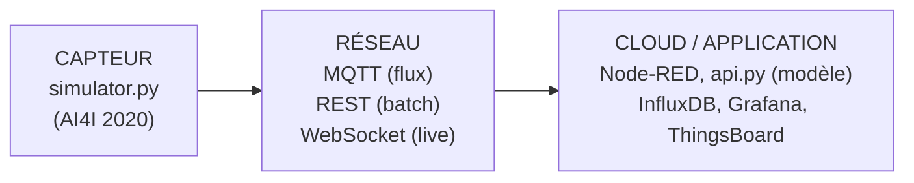
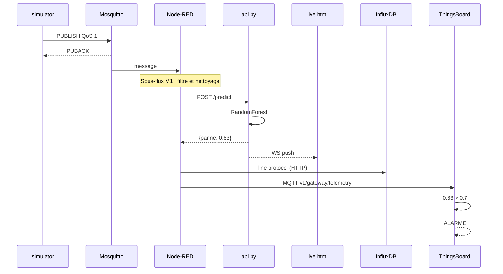

# 00 · Vue d'ensemble du projet

## L'objectif en une phrase
Prévenir **avant** qu'une machine tombe en panne : on observe ses capteurs (températures, vitesse,
couple, usure de l'outil), un modèle d'IA calcule une **probabilité de panne** (`panne_probable`),
et si elle dépasse un seuil une **alarme CRITICAL** est levée.

## Ce que demande le sujet (PDF §12, Projet 11)
| Exigence | Où c'est fait |
|---|---|
| Capteur : rejeu d'un dataset (AI4I 2020) en Python | `src/simulator.py` |
| MQTT QoS 1 pour le flux | simulateur → Mosquitto (`usine/<machine>/telemetry`) |
| REST pour l'historique (`GET /api/plugins/telemetry/...`) | `src/rest_history.py` |
| WebSocket pour pousser `panne_probable` en temps réel | `src/api.py` (`/ws`) → `src/live.html` |
| InfluxDB + Grafana + modèle ML (RandomForest) | `ml/train.py`, `configs/grafana_dashboard.json` |
| Rule Engine ThingsBoard : alarme CRITICAL si `panne_probable > 0.7` | `configs/tb_rule_chain.json` |
| Attribut partagé : seuil modifiable sans redéploiement | attribut `threshold` sur chaque device |
| Sous-flux Node-RED réutilisable pour plusieurs machines | sous-flux `Prétraitement_Machine` (paramètre `machine_id`) |
| Livrables : notebook, dashboard, export d'alarme, rapport de perf, tableau des protocoles | `ml/train.ipynb`, captures `docs/img/`, `reports/benchmark.md` |

## Les 3 couches

Chaque couche est détaillée dans :
- [01_couche_capteur.md](01_couche_capteur.md)
- [02_couche_reseau.md](02_couche_reseau.md)
- [03_couche_cloud.md](03_couche_cloud.md)
- [04_modele_ml.md](04_modele_ml.md)

## Le trajet d'UNE mesure (à savoir raconter)

1. Le simulateur lit une ligne du CSV et la publie en MQTT (QoS 1) ; le broker répond PUBACK.
2. Node-RED est abonné à `usine/+/telemetry` ; l'instance du sous-flux de la bonne machine la prend.
3. Le sous-flux nettoie la mesure puis appelle le modèle (`POST /predict`).
4. L'API calcule `panne_probable`, la **pousse en WebSocket** à la page live et la renvoie à Node-RED.
5. Node-RED écrit mesure + prédiction dans **InfluxDB** (lu par Grafana) et l'envoie à **ThingsBoard**.
6. La **rule chain** ThingsBoard compare au seuil `threshold` (attribut partagé) → alarme ou effacement.
7. Plus tard, `rest_history.py` récupère l'historique en **REST** pour ré-entraîner le modèle.

## Ports et services
| Service | Port | Rôle |
|---|---|---|
| Mosquitto | 1883 | broker MQTT |
| Node-RED | 1880 | orchestration low-code |
| ThingsBoard | 8080 (web/REST), 1884 (MQTT) | rule engine, alarmes, attributs |
| InfluxDB | 8086 | base de séries temporelles |
| Grafana | 3000 | dashboard |
| api.py | 8000 | modèle ML (REST) + WebSocket + page live |

ThingsBoard intègre lui aussi un broker MQTT sur 1883 **dans son conteneur** ; on l'expose sur 1884
côté machine hôte pour ne pas entrer en conflit avec Mosquitto.
