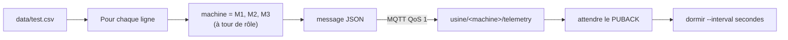

# 01 · Couche CAPTEUR : données AI4I 2020 et simulateur

## Pourquoi un dataset plutôt que de vrais capteurs ?
Le sujet impose des **données simulées** (pas de matériel). On utilise **AI4I 2020 Predictive Maintenance**
(UCI) : 10 000 relevés d'une machine-outil, conçu pour reproduire des pannes industrielles réelles.

## Les colonnes du dataset
| Colonne | Signification | Utilisée par le modèle ? |
|---|---|---|
| UDI, Product ID | identifiants | non (aucune info physique) |
| Type | qualité du produit : L (50 %), M (30 %), H (20 %) | oui (encodé 0/1/2) |
| Air temperature [K] | température ambiante | oui |
| Process temperature [K] | température du procédé (≈ air + 10 K) | oui |
| Rotational speed [rpm] | vitesse de rotation de la broche | oui |
| Torque [Nm] | couple | oui |
| Tool wear [min] | usure de l'outil (minutes d'utilisation) | oui |
| **Machine failure** | **0 / 1 : la cible à prédire** | cible |
| TWF, HDF, PWF, OSF, RNF | **mode** de la panne (usure, dissipation thermique, puissance, surcharge, aléatoire) | **non : fuite de données** |

Les 5 modes de panne ne sont connus **qu'après** la panne. Les donner au modèle reviendrait à lui
donner la réponse : il aurait un score parfait en test et serait inutile en production.

## Le simulateur : `src/simulator.py`

Exemple de message publié :
```json
{"machine_id": "M2", "ts": 1794709178916, "type": "L",
 "air_temp_k": 298.9, "process_temp_k": 309.1, "rpm": 1384.0,
 "torque_nm": 51.2, "tool_wear_min": 143.0, "panne_reelle": 0}
```
- `ts` : horodatage **actuel** en ms (on simule un capteur qui mesure maintenant).
- `panne_reelle` : la vérité du dataset, **jamais** utilisée par le modèle. Elle sert seulement à
  comparer prédiction et réalité dans les dashboards.

### Pourquoi rejouer `test.csv` et pas tout le dataset ?
`ml/train.py` sépare les données en 80 % entraînement / 20 % test. Le simulateur ne rejoue que les
**20 % jamais vus par le modèle**, sinon on mesurerait sa mémoire et non sa capacité à prédire.

### Options utiles
| Option | Effet |
|---|---|
| `--interval 0.5` | un message toutes les 0,5 s |
| `--limit 100` | s'arrête après 100 messages (0 = infini) |
| `--machines M1,M2` | nombre / noms des machines simulées |
| `--demo` | sur-représente les pannes (~20 %) pour voir des alarmes rapidement en démo |

### Pourquoi QoS 1 ?
- **QoS 0** (« au plus une fois ») : pas d'accusé, une mesure peut se perdre sans qu'on le sache.
- **QoS 1** (« au moins une fois ») : le broker renvoie un **PUBACK** ; sans accusé, le client renvoie.
  Doublon possible, mais aucune perte. Pour de la télémétrie horodatée, un doublon est sans gravité.
- **QoS 2** (« exactement une fois ») : 4 échanges par message, inutilement lourd ici.

## Générateur synthétique de secours
Si le téléchargement UCI échoue (pas d'Internet), `ml/train.py` génère 10 000 lignes avec **le même
schéma** et **les mêmes règles de panne** que la publication AI4I (ex. HDF si écart de température
< 8,6 K et vitesse < 1 380 tr/min ; PWF si puissance hors [3 500, 9 000] W ; OSF si usure × couple
dépasse 11 000 / 12 000 / 13 000 selon le type). Le reste du pipeline fonctionne à l'identique.
