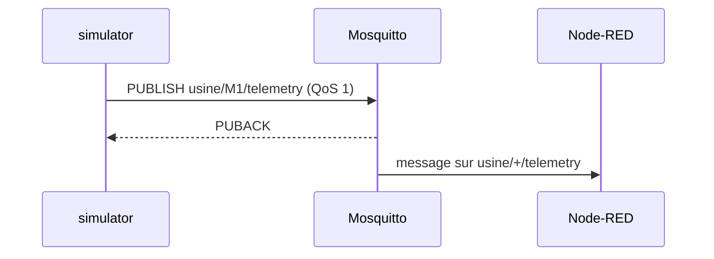
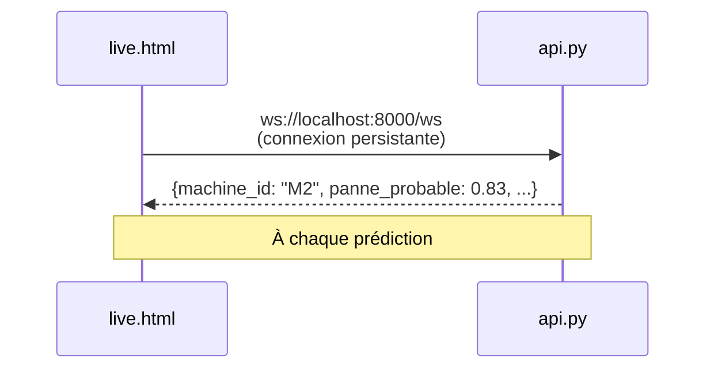

# 02 · Couche RÉSEAU : MQTT, REST et WebSocket

Le sujet demande de **choisir, justifier et comparer** les protocoles. Chacun a ici un rôle unique.

## MQTT : le flux de mesures

- **Publish / subscribe** : le capteur publie sur un **topic**, sans savoir qui écoute. Le **broker**
  (Mosquitto) distribue aux abonnés. On peut ajouter un consommateur sans toucher au capteur.
- **Topics hiérarchiques** : `usine/<machine>/telemetry`. Le joker `+` remplace un niveau :
  `usine/+/telemetry` = toutes les machines.
- **Léger** : en-tête de 2 octets minimum, connexion TCP gardée ouverte. Pensé pour des capteurs
  contraints et des réseaux instables.
- **QoS 1** : accusé PUBACK, aucune perte (voir [01_couche_capteur.md](01_couche_capteur.md)).
- Node-RED parle aussi MQTT à ThingsBoard via l'**API passerelle** (`v1/gateway/telemetry`) :
  **une seule connexion** pour toutes les machines, au lieu d'une connexion par device.

## REST / HTTP : les échanges ponctuels (batch)
Deux usages :
1. **Historique pour le ré-entraînement** (`src/rest_history.py`) :
   ```mermaid
   sequenceDiagram
       participant H as rest_history.py
       participant T as ThingsBoard REST
       H->>T: POST /api/auth/login
       T-->>H: jeton JWT
       H->>T: GET /api/tenant/devices?deviceName=M1
       T-->>H: id du device
       H->>T: GET /api/plugins/telemetry/DEVICE/{id}/values/timeseries
       T-->>H: historique JSON
   ```
   → `data/history.csv`, prêt à ré-entraîner le modèle sur des données récentes.
2. **Appel du modèle** : Node-RED fait `POST /predict` sur `api.py` et attend la réponse.

Pourquoi REST ici ? Ce sont des **questions** qui attendent **une réponse**, à une fréquence faible.
HTTP est universel, sans état, sécurisable (JWT, HTTPS) ; son overhead ne pèse pas sur des appels rares.

## WebSocket : le push en direct vers le navigateur

- Démarre par une requête HTTP « Upgrade », puis la connexion TCP reste ouverte dans **les deux sens**.
- Le **serveur pousse** sans que le client demande, ce que REST ne sait pas faire.
- Alternative écartée : du *polling* REST (la page redemande toutes les secondes). Cela fait plus de
  latence, environ 500 octets d'en-têtes par requête même sans nouvelle valeur, et une charge serveur inutile.
- Pourquoi pas MQTT jusqu'au navigateur ? Un navigateur ne parle pas MQTT/TCP. Il faudrait du
  MQTT-over-WebSocket, donc de toute façon un WebSocket.

## Benchmark mesuré : `src/benchmark.py`
Même payload JSON (191 octets), **100 messages par protocole**, mesure du temps « envoi → accusé » :
- MQTT : PUBLISH QoS 1 → **PUBACK** du broker
- REST : `POST /bench` → **réponse HTTP 200** (connexion keep-alive réutilisée)
- WebSocket : trame sur `/ws/bench` → **trame de réponse** (connexion unique)

Les endpoints `/bench` ne lancent **pas** le modèle : on compare le **transport**, pas le calcul du
RandomForest. Un message d'échauffement par protocole n'est pas compté, pour exclure l'ouverture de connexion.

| Protocole | Latence moy. (ms) | p95 (ms) | Payload (o) | Overhead (o) | Total / msg (o) | Overhead (%) | Fiabilité |
|---|---|---|---|---|---|---|---|
| MQTT (QoS 1) | 0,60 | 0,79 | 191 | 26 | 217 | 12,0 % | 100 % |
| REST / HTTP 1.1 | 1,24 | 1,77 | 191 | 317 | 508 | 62,4 % | 100 % |
| WebSocket | 0,39 | 0,69 | 191 | 21 | 212 | 9,9 % | 100 % |

**Comment l'overhead est compté** (hors en-têtes TCP/IP, communs aux trois) :
- MQTT : 1 octet type/flags + longueur restante (2 o) + longueur du topic (2 o) + topic (15 o)
  + identifiant de paquet (2 o) + PUBACK (4 o) = **26 o**
- REST : ligne de requête + en-têtes HTTP réellement envoyés (Host, User-Agent, Content-Type…) + ligne
  de statut, en-têtes et corps de la réponse ≈ **317 o**
- WebSocket : en-tête de trame client (4 o + 4 o de masque) + trame réponse (2 o + corps) = **21 o**

**Lecture** :
- REST coûte **~12× plus d'octets de protocole** que MQTT pour le même message : rédhibitoire pour un
  flux continu de capteurs, acceptable pour des requêtes ponctuelles.
- MQTT et WebSocket sont proches. MQTT apporte en plus le **broker** (découplage, QoS, persistance des
  messages, topics) : c'est un protocole IoT, WebSocket n'est qu'un « tuyau ».
- Les latences sont toutes sub-milliseconde **en local**. Sur un vrai réseau (Wi-Fi, 4G) les écarts
  grandissent, surtout pour REST si la connexion n'est pas réutilisée (poignée de main TCP + TLS).
- Fiabilité 100 % partout en local. L'intérêt du QoS 1 se voit sur un réseau qui coupe.

Résultats bruts : [../reports/benchmark.md](../reports/benchmark.md) et `reports/benchmark.csv`.
