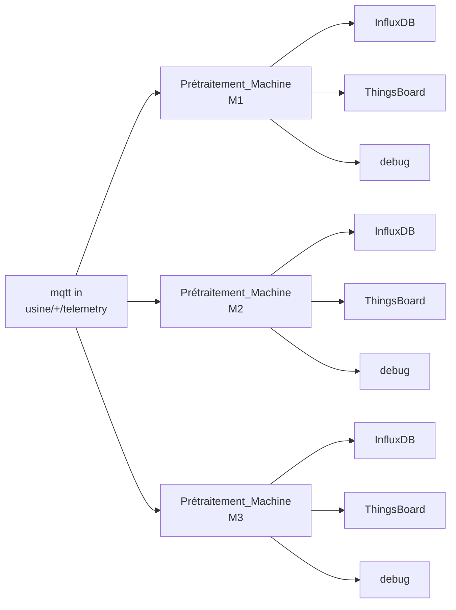
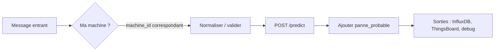
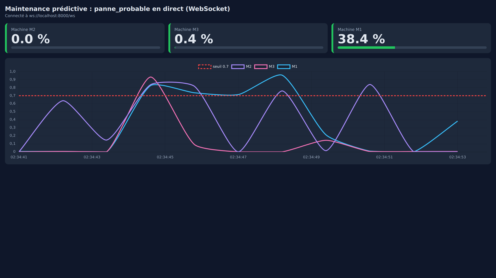
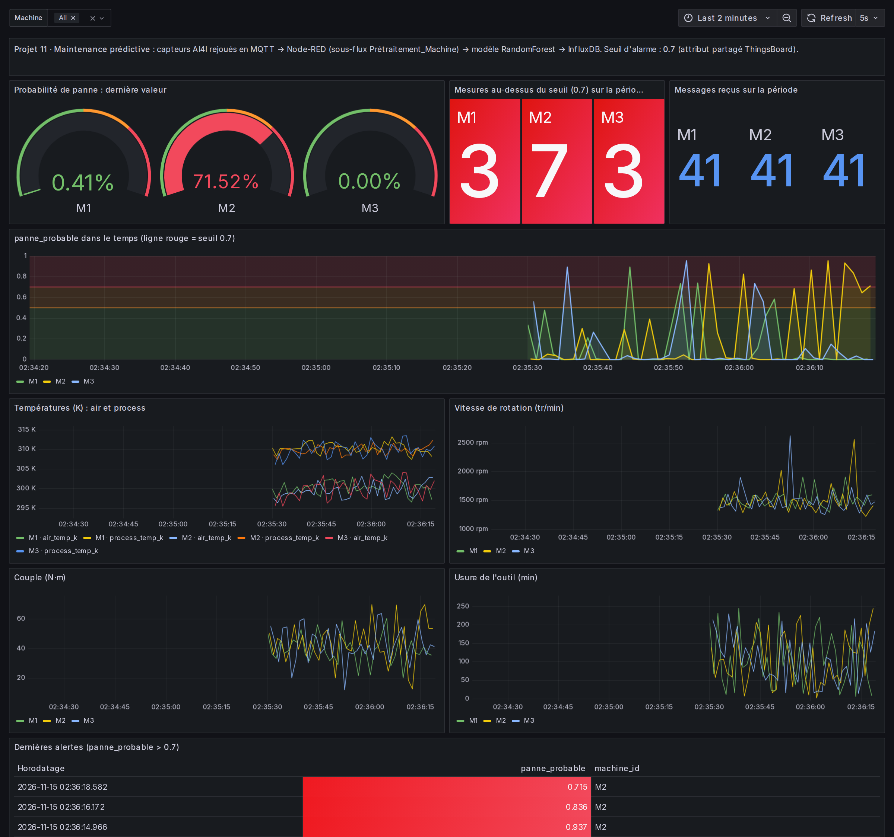
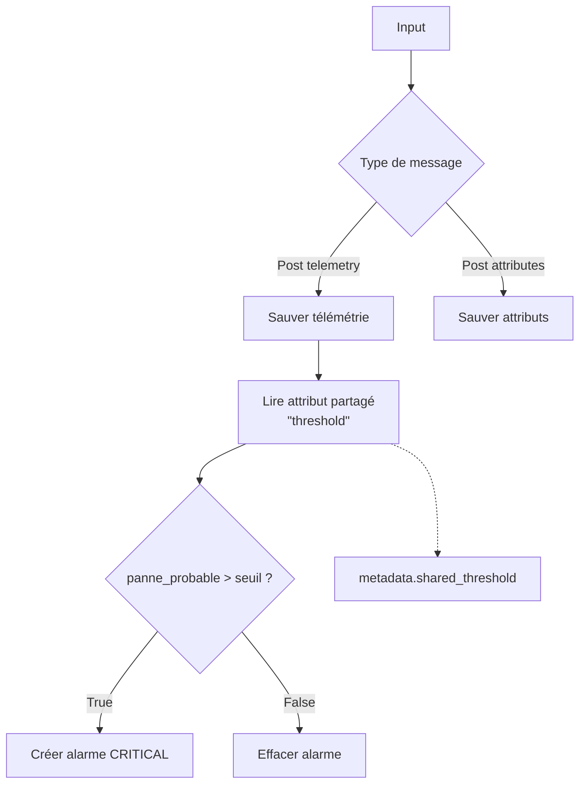
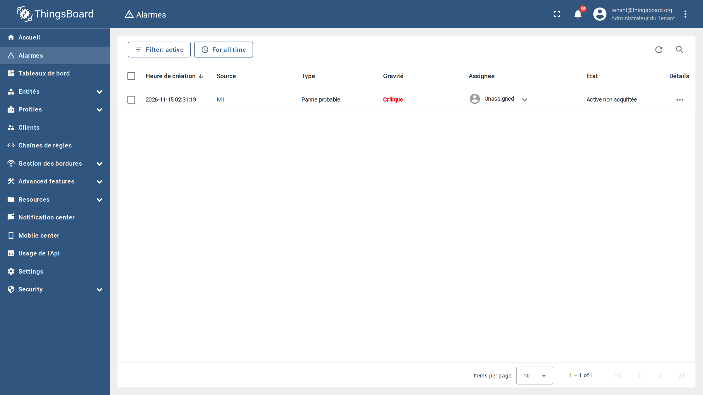

# 03 · Couche CLOUD / APPLICATION

Tout tourne en local avec `docker compose up -d` (5 conteneurs) + `uvicorn` pour l'API.

## Mosquitto : broker MQTT
- Reçoit les messages des capteurs et les distribue aux abonnés (ici Node-RED).
- Config `mosquitto/mosquitto.conf` : port 1883, accès anonyme (local), **persistance** activée pour
  ne pas perdre les messages QoS 1 en attente si le broker redémarre.
- **Pourquoi Mosquitto ?** Référence open source (Eclipse), très léger (quelques Mo de RAM), conforme
  MQTT 3.1.1 / 5. En production on ajouterait authentification + TLS (port 8883).

## Node-RED : orchestration et sous-flux


- `mqtt in` sur `usine/+/telemetry` → **3 instances** du sous-flux (M1, M2, M3) → 3 sorties :
  InfluxDB, ThingsBoard, debug.

### Le sous-flux `Prétraitement_Machine` (fonctionnalité avancée demandée)


| Nœud | Rôle |
|---|---|
| **Ma machine ?** (switch) | ne laisse passer que les messages dont `machine_id` = le paramètre de l'instance |
| **Normaliser / valider** (function) | convertit en nombres, rejette un message incomplet, met un type par défaut |
| **POST /predict** (http request) | appelle le modèle ML (`api.py`) |
| **Ajouter panne_probable** (function) | fusionne la mesure et la prédiction ; statut vert/rouge |

Un sous-flux est un **composant réutilisable** : le même code est utilisé 3 fois, seul le paramètre
`machine_id` change. Pour ajouter une 4ᵉ machine, il suffit d'ajouter une instance. Une correction
dans le sous-flux s'applique à toutes les machines.

Sorties :
- **InfluxDB** : un nœud `function` fabrique le *line protocol*, puis `http request` fait
  `POST /api/v2/write`. Aucun plugin à installer.
  ```mermaid
  flowchart LR
      M["machine"] --> T["machine_id=M2<br/>(tag)"]
      T --> F["air_temp_k=298.9, ...<br/>panne_probable=0.83, type=&quot;L&quot;, panne_reelle=1i<br/>(champs)"]
      F --> TS["1794709178916<br/>(horodatage ms)"]
  ```
- **ThingsBoard** : `mqtt out` sur `v1/gateway/telemetry` (Node-RED = **passerelle** ThingsBoard) :
  `{"M2": [{"ts": ..., "values": {...}}]}`. ThingsBoard rattache les valeurs au device `M2`.
- **Pourquoi Node-RED ?** Programmation visuelle, idéale pour **router** des messages entre protocoles
  (MQTT, HTTP), avec des sous-flux réutilisables. On voit le flux, ce qui le rend facile à expliquer.

## api.py : le modèle servi en REST + WebSocket
- **FastAPI** : `POST /predict` (validation automatique des entrées via Pydantic : une température de
  1 000 K est refusée avec une erreur 422), `WS /ws` (push), `GET /` (page live).
- Le modèle est chargé **une seule fois** au démarrage, pas à chaque requête.
- Chaque prédiction est diffusée à toutes les pages `live.html` connectées.



## InfluxDB v2 : base de séries temporelles
- Organisation `usine`, bucket `maintenance`, créés automatiquement par les variables d'environnement
  du `docker-compose.yml`.
- Mesure `machine`, **tag** `machine_id` (indexé, pour filtrer), **champs** = valeurs capteurs +
  `panne_probable` + `panne_reelle`.
- **Pourquoi InfluxDB plutôt que PostgreSQL ?** Conçu pour des données horodatées à haute fréquence :
  écriture rapide, compression, fonctions temporelles natives (`aggregateWindow`, `last`, rétention).

## Grafana : le dashboard


Provisionné automatiquement (datasource + dashboard, aucun clic). Panneaux :
- **jauges** : dernière `panne_probable` par machine (vert < 0,5 < orange < 0,7 < rouge)
- compteur des mesures au-dessus du seuil, nombre de messages reçus
- **courbe** `panne_probable` avec la ligne de seuil 0,7
- courbes capteurs : températures, vitesse, couple, usure
- tableau des dernières alertes
- variable `Machine` pour filtrer une ou plusieurs machines
Requêtes en **Flux**, par ex. `|> aggregateWindow(every: v.windowPeriod, fn: max)`.

## ThingsBoard CE : Rule Engine, attribut partagé, alarmes

Le script (langage TBEL) :
```js
var seuil = 0.7;
if (metadata.shared_threshold != null) { seuil = parseFloat(metadata.shared_threshold); }
return msg.panne_probable != null && msg.panne_probable > seuil;
```
- **Attribut partagé** (`SHARED_SCOPE`) : valeur stockée **sur le device**, modifiable depuis l'UI ou
  l'API, et lue par la rule chain **à chaque message**. On change le seuil **sans redéployer** ni
  modifier la rule chain.
  Vérifié : avec `threshold = 0.3` sur M2, une prédiction de 0,39 crée une alarme dont le détail
  affiche `"seuil": "0.3"`.
- **Alarme** : type « Panne probable », gravité **CRITICAL**. Une alarme active n'est pas recréée à
  chaque message (elle est mise à jour) ; elle est **effacée** automatiquement quand la probabilité
  redescend sous le seuil.



- **Pourquoi ThingsBoard ?** Plateforme IoT complète et open source : gestion de devices, Rule Engine,
  attributs, alarmes, dashboards, API REST. On y délègue la logique d'alerte au lieu de la coder.
