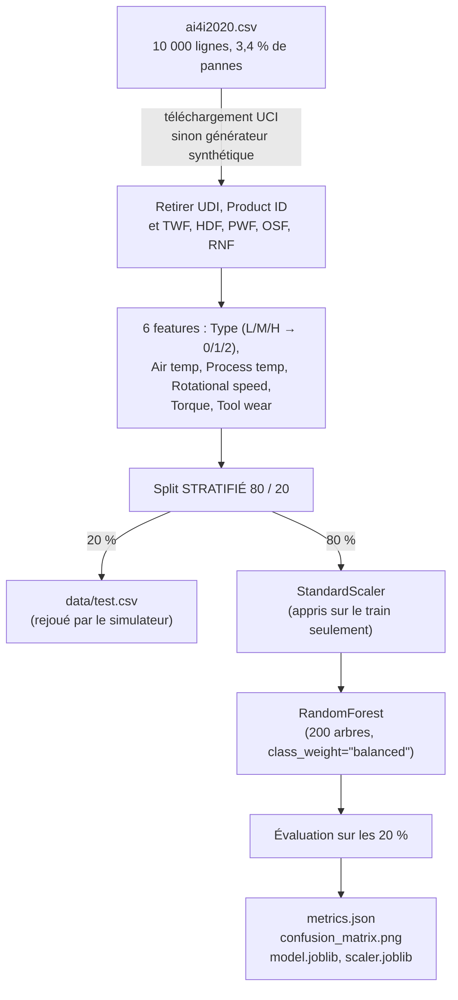
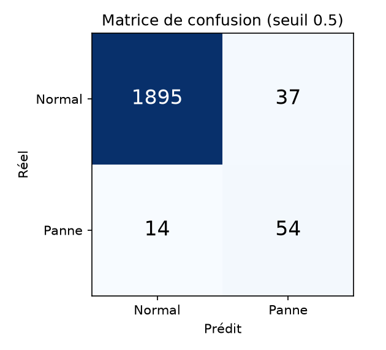

# 04 · Le modèle de Machine Learning

Code : `ml/train.py` (script) et `ml/train.ipynb` (même chose, pas à pas, déjà exécuté).

## Le pipeline

La transformation des features est dans **un seul fichier** (`ml/features.py`), utilisé à
l'entraînement **et** par l'API : le modèle reçoit exactement les mêmes colonnes en production.

## Le déséquilibre des classes
Seulement **3,4 %** de pannes. Un modèle qui répond toujours « pas de panne » aurait 96,6 %
d'*accuracy*… et ne détecterait rien. D'où :
- **pas d'accuracy** comme métrique ; on regarde précision, rappel, F1 et ROC-AUC ;
- **split stratifié** : la même proportion de pannes dans le train et le test ;
- **`class_weight="balanced"`** : chaque erreur sur une panne coûte ~28× plus cher (96,6 / 3,4) pendant
  l'apprentissage, ce qui force le modèle à s'y intéresser.

## Résultats (jeu de test, 2 000 lignes dont 68 pannes)
| | Seuil 0,5 | Seuil 0,7 (alarme) |
|---|---|---|
| Précision | 0,593 | **0,833** |
| Rappel | **0,794** | 0,662 |
| F1 | 0,679 | 0,738 |
| ROC-AUC | 0,971 | 0,971 |

Matrice de confusion (seuil 0,5) : 54 pannes détectées, **14 ratées**, 37 fausses alertes,
1 895 cas normaux bien classés.

### Comment lire ces chiffres
- **Rappel** = pannes détectées / pannes réelles = 54 / 68 = 79 %. C'est la métrique prioritaire en
  maintenance : une panne ratée coûte un arrêt de production, une fausse alerte coûte une inspection.
- **Précision** = vraies pannes parmi les alertes = 54 / 91 = 59 %.
- **ROC-AUC 0,97** : en tirant une machine en panne et une machine saine au hasard, le modèle donne
  une probabilité plus haute à celle en panne dans 97 % des cas. C'est indépendant du seuil.
- **Le seuil est un curseur** : à 0,7 on a moins de fausses alertes (précision 0,83) mais on rate
  plus de pannes (rappel 0,66). Ce choix métier est réglable à chaud via l'attribut ThingsBoard.

### Variables les plus importantes
Couple (0,34), vitesse de rotation (0,28), usure de l'outil (0,22), température de l'air (0,09).
C'est cohérent avec la physique : surcharge = couple × usure, puissance = couple × vitesse.

## Pourquoi un RandomForest et pas un LSTM ?
- Les données AI4I sont des **relevés indépendants** (une ligne = un état), sans vraie séquence
  temporelle par machine. Un LSTM a besoin de **séquences**, sans intérêt ici.
- Le RandomForest marche très bien sur des **données tabulaires**, sans normalisation, avec peu de
  réglages, et donne l'**importance des variables** (explicable).
- Rapide : ~11 ms par prédiction (~15 ms via `POST /predict`), largement suffisant pour un message par
  seconde et par machine. Astuce mesurée : pour **une seule** ligne, `n_jobs=1` est 6× plus rapide
  que `n_jobs=-1` (70 ms), car lancer des threads sur tous les cœurs coûte plus que le calcul.
- Le `StandardScaler` n'est pas nécessaire pour une forêt (les arbres coupent sur des seuils) ; il est
  conservé car demandé et utile si l'on change de modèle (régression logistique, réseau de neurones).

## Ré-entraînement
`src/rest_history.py` récupère en REST l'historique stocké dans ThingsBoard → `data/history.csv`.
On pourrait l'ajouter aux données d'entraînement et relancer `python -m ml.train` périodiquement.
